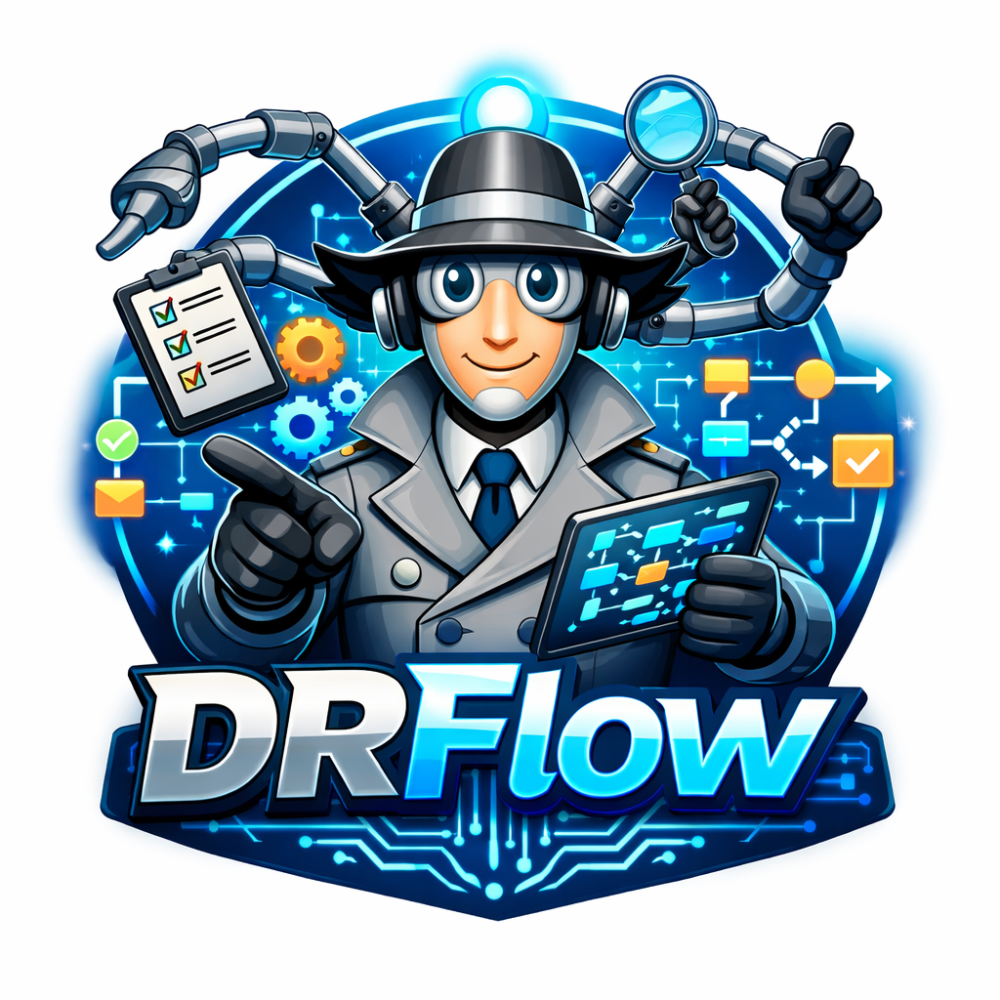

# DRFLOW: A Deep Research Benchmark for Personalized Workflow Prediction

<p align="center">
  
</p>

[](https://arxiv.org/abs/2606.18191)

**`DRFLOW`** is a deep research benchmark designed to evaluate agents on
**personalized workflow prediction** for complex enterprise tasks.

It tests an agent's ability to connect evidence across **public and private data
sources** and turn that evidence into an **ordered sequence of action steps**
tailored to a user's goals and constraints.

## News

- 🎉 DRFLOW has been accepted at EMNLP 2026!
- 🤗 The benchmark is coming to Hugging Face soon!

## Quick Start

Run the following commands from this directory. Python 3.10 or later is required.

### Install Requirements

```bash
uv venv
source .venv/bin/activate
uv pip install -e .
cp env_template .env
```

Populate `.env` with your credentials. The default local and Docker examples use
`OPENROUTER_API_KEY` for report generation, embeddings, and evaluation. Set
`SERPER_API_KEY` to enable internet search. Keep `.env` private; it is ignored by
Git. Values in `.env` override existing shell environment variables.

### Run Locally Without Docker

```bash
python minimal_local.py
```

This runs only the DRFLOW agent on the bundled `b2b_04` task, using the task's
local files directly, then evaluates the generated workflow with all six DRFLOW
metrics. Docker installation and service startup are unnecessary for this mode.
Model APIs still require an internet connection and credentials.

Choose another bundled task or change the model settings:

```bash
python minimal_local.py --task-id education_10
python minimal_local.py --task-id legal_01 --max-iterations 5
python minimal_local.py --help
```

The defaults are `openrouter/openai/gpt-5.2` for generation,
`openrouter/openai/text-embedding-ada-002` for embeddings, and `gpt-4o-mini` for
evaluation. Use `--model`, `--embedding-model`, and `--eval-model` to change them.
Direct OpenAI models require `OPENAI_API_KEY`; the default embeddings require
`OPENROUTER_API_KEY` unless you also change `--embedding-model`.

Each run writes its report and workflow spreadsheet under
`outputs/research_workspace/<run_id>/`, its vector store under
`outputs/vector_stores/<run_id>/`, and its Markdown and JSON evaluation reports
under `results/minimal_local_drflow/<run_id>/`.

### Run with Docker Services

To use the simulated enterprise applications, install
[Docker](https://www.docker.com/get-started/) and build the services image:

```bash
cd services
make local-build
cd ..
python minimal_docker.py
```

The initial image build takes around 30 minutes and only needs to be done once.
This example also uses the bundled `b2b_04` task.

## Citation

If you use DRFLOW in your work, please cite:

```bibtex
@misc{khondaker2026drflowdeepresearchbenchmark,
  title={DRFLOW: A Deep Research Benchmark for Personalized Workflow Prediction},
  author={Md Tawkat Islam Khondaker and Raymond Li and Muhammad Abdul-Mageed and Laks V. S. Lakshmanan and Issam H. Laradji},
  year={2026},
  eprint={2606.18191},
  archivePrefix={arXiv},
  primaryClass={cs.AI},
  url={https://arxiv.org/abs/2606.18191},
}
```

## Acknowledgement

This repository is built on [DRBench](https://github.com/ServiceNow/drbench).
